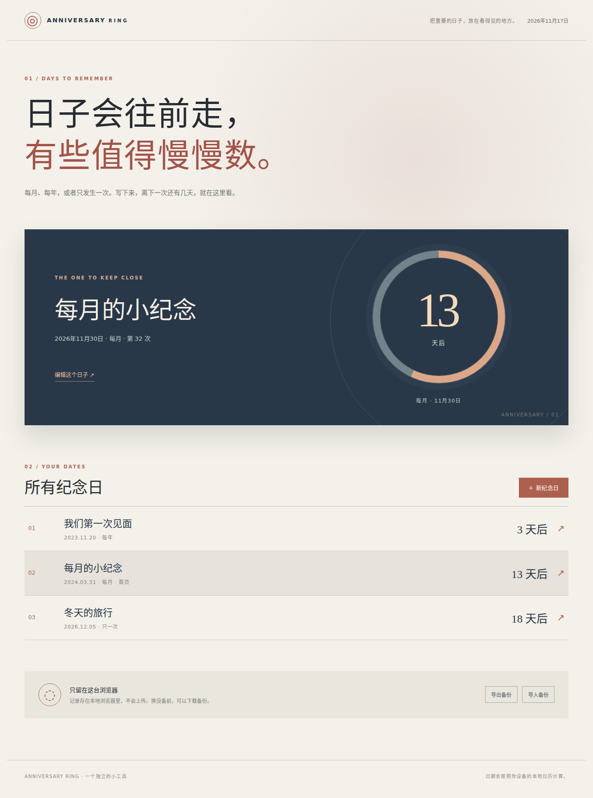

# Anniversary Ring · 纪念日圆环

从面板纪念日功能独立整理的静态网页。支持每月、每年、单次事件，自动计算倒数、已过去天数和周期进度；每月 31 日会在短月份落到月末，闰年 2 月 29 日会在非闰年落到 2 月 28 日。



## 运行

```bash
python3 -m http.server 8000
```

打开 `http://localhost:8000`。无需账号、后端或任何运行时依赖。浏览器的 `localStorage` 最多保存 100 个纪念日；页面提供 JSON 备份导出和导入，导入会替换当前记录。截图里的名字是浏览器测试写入的示例数据，仓库里不包含私人记录。

## 测试

```bash
npm ci
npx playwright install chromium
npm test
```

浏览器测试覆盖桌面和手机尺寸的新增、编辑、刷新后保留、备份下载，并生成实际网页截图。日期测试覆盖月末与闰年规则。

代码采用 [MIT License](LICENSE)。
